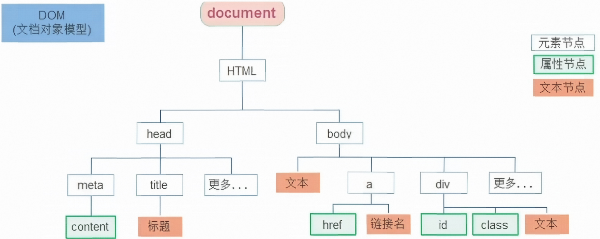

# 节点介绍

## DOM 节点

DOM 树里的每一个内容称之为节点。




## 节点类型

1. 元素节点

   - 所有的标签，比如 `body`、`div`。
   - `html` 是根节点。

2. 属性节点

   所有的属性，比如 `herf`。

3. 文本节点

   所有的文本。例如，在 `<p>你好</p>` 中，“你好”就是一个文本节点。它是元素节点的子节点。

4. 其他

# 节点关系

## 父节点

在 JavaScript 中，用于获取一个节点父节点的属性主要有两个：`parentNode` 和 `parentElement`。它们虽然功能相似，但在处理细节上存在关键区别。

### `parentNode`

`Node.parentNode` 是一个只读属性，它返回指定节点的父节点。

- 返回类型

  `Node` 对象。

- 核心特点

  在 DOM 树中，任何类型的节点（包括元素节点、文档节点 `document`、文档片段节点 `DocumentFragment`）都可以拥有父节点。

- 特殊情况

  如果当前节点是顶层节点（如 `document` 本身），或者该节点尚未被添加到 DOM 树中，则 `parentNode` 属性返回 `null`。

### `parentElement`

`Node.parentElement` 也是一个只读属性，但它更具体，它只返回指定节点的父**元素**节点。

- 返回类型

  `Element` 对象。

- 核心特点

  它只关心父节点是否为元素节点（即 HTML 标签）。

- 特殊情况

  如果父节点不是元素节点（例如是 `Document` 或 `DocumentFragment`），或者当前节点没有父节点，则 `parentElement` 属性返回 `null`。

### 两者区别对比

为了更清晰地理解它们的差异，请看下表：

| 特性                    | `parentNode`         | `parentElement`     |
| ----------------------- | -------------------- | ------------------- |
| **返回类型**            | `Node` 对象          | `Element` 对象      |
| **关注点**              | 任何类型的父节点     | 仅限父**元素**节点  |
| **父节点为 `<div>`**    | 返回该 `<div>` 元素  | 返回该 `<div>` 元素 |
| **父节点为 `document`** | 返回 `document` 对象 | 返回 `null`         |

- 当你需要操作父节点，并且确定它一定是一个 HTML 元素时，使用 `parentElement` 更为精确和安全。
- 当你需要处理更通用的节点关系，或者不确定父节点类型时，`parentNode` 的适用范围更广。

### 代码示例

```javascript
// 假设 HTML 结构为 <div id="parent"><span id="child">文本</span></div>

const childNode = document.getElementById('child');

// 1. 获取父元素节点
const parentElement = childNode.parentElement;
console.log(parentElement); // 输出: <div id="parent">...</div>
console.log(parentElement.id); // 输出: "parent"

// 2. 获取父节点
const parentNode = childNode.parentNode;
console.log(parentNode); // 输出: <div id="parent">...</div>

// 3. 关键区别演示
// document 节点的父节点是 null
console.log(document.parentNode);     // 输出: null
console.log(document.parentElement);  // 输出: null

// 创建一个尚未添加到 DOM 的元素
const newDiv = document.createElement('div');
console.log(newDiv.parentNode);     // 输出: null
console.log(newDiv.parentElement);  // 输出: null
```

## 所有子结点

在 JavaScript 中，获取一个节点的子节点主要使用两个属性：`childNodes` 和 `children`。

### `childNodes`

`Node.childNodes` 是一个只读属性，它返回一个实时的 `NodeList`，其中包含给定节点的所有子节点。

- 返回内容

  包含**所有**类型的子节点，包括元素节点、文本节点（如标签之间的空白字符、换行符）以及注释节点。

- 核心特点

  它是实时的（Live），这意味着每当 DOM 中有新的子节点被添加或移除时，这个 `NodeList` 的内容会自动更新。

- 常见陷阱

  由于浏览器会在文档中插入文本节点来表示源代码中的空白字符，因此通过 `childNodes[0]` 获取的第一个节点，可能并不是你期望的元素节点，而是一个空白文本节点。

### `children`

`Element.children` 是一个只读属性，它返回一个实时的 `HTMLCollection`，仅包含给定元素的子**元素**节点。

- 返回内容

  **仅包含元素节点**（即 HTML 标签），完全过滤掉了文本节点和注释节点。

- 核心特点

  在现代前端开发中，由于我们绝大多数时候只关心 HTML 标签，因此 `children` 是更常用、更安全的属性。

### 两者区别对比

为了更清晰地理解它们的差异，请看下表：

| 特性               | `childNodes`                       | `children`                 |
| ------------------ | ---------------------------------- | -------------------------- |
| **返回类型**       | `NodeList` 对象                    | `HTMLCollection` 对象      |
| **包含内容**       | 元素节点、文本节点、注释节点等     | 仅包含元素节点             |
| **受空白字符影响** | 是（换行和空格会被识别为文本节点） | 否（自动忽略空白文本节点） |
| **适用场景**       | 需要处理纯文本或注释时             | 日常 DOM 操作（强烈推荐）  |

### 代码示例

```javascript
// 假设 HTML 结构如下：
// <ul id="list">
//     <li>项目 1</li>
//     <li>项目 2</li>
// </ul>

const list = document.getElementById('list');

// 1. 使用 childNodes（包含换行符和空格产生的文本节点）
console.log(list.childNodes.length); 
// 输出: 5 （包含 2 个 <li> 元素节点，以及 3 个文本节点）

// 2. 使用 children（仅获取元素节点）
console.log(list.children.length); 
// 输出: 2 （仅包含 2 个 <li> 元素节点）

// 3. 遍历子元素（日常开发推荐写法）
for (let i = 0; i < list.children.length; i++) {
    console.log(list.children[i].textContent);
}
```

## 单个子节点

### 获取第一个子节点

- `firstChild`

  返回父节点的第一个子节点。如果父节点没有子节点，则返回 `null`。它包含元素节点、文本节点（如换行符、空格）和注释节点。

- `firstElementChild`

  返回父节点的第一个子**元素**节点。它会自动忽略文本节点和注释节点。如果不存在，返回 `null`。

### 获取最后一个子节点

- **`lastChild`**

  返回父节点的最后一个子节点。同样，它包含所有类型的节点。

- **`lastElementChild`**

  返回父节点的最后一个子**元素**节点。它会自动忽略文本节点和注释节点。如果不存在，返回 `null`。

### 核心区别与避坑指南

| 属性                                     | 返回内容                       | 常见陷阱                                                     |
| ---------------------------------------- | ------------------------------ | ------------------------------------------------------------ |
| `firstChild` / `lastChild`               | 包含元素、文本、注释等所有节点 | 如果 HTML 标签之间有空格或换行，`firstChild` 极有可能返回一个空白文本节点，而不是你期望的 HTML 标签。 |
| `firstElementChild` / `lastElementChild` | 仅包含元素节点（HTML 标签）    | 现代开发中**强烈推荐**使用这两个属性，它们能精准定位到标签，完全不受代码排版格式的影响。 |

### 4. 代码示例

```javascript
// 假设 HTML 结构如下：
// <div id="box">
//     <p>第一个段落</p>
//     <p>第二个段落</p>
// </div>

const box = document.getElementById('box');

// 1. 使用 firstChild（容易踩坑）
console.log(box.firstChild); 
// 输出: 一个文本节点（代表 <div> 和 <p> 之间的换行符和空格）

// 2. 使用 firstElementChild（安全且推荐）
console.log(box.firstElementChild); 
// 输出: <p>第一个段落</p> （精准获取到第一个 p 标签）

// 3. 获取最后一个子元素
console.log(box.lastElementChild); 
// 输出: <p>第二个段落</p>
```

## 兄弟节点

### 获取前一个兄弟节点

- **`previousSibling`**

  返回当前节点的前一个兄弟节点。它包含元素节点、文本节点（如换行符、空格）和注释节点。如果当前节点已经是第一个子节点，则返回 `null`。

- **`previousElementSibling`**

  返回当前节点的前一个兄弟**元素**节点。它会自动忽略文本节点和注释节点。如果不存在，则返回 `null`。

### 获取后一个兄弟节点

- `nextSibling`

  返回当前节点的后一个兄弟节点。同样，它包含所有类型的节点。如果当前节点已经是最后一个子节点，则返回 `null`。

- `nextElementSibling`

  返回当前节点的后一个兄弟**元素**节点。它会自动忽略文本节点和注释节点。如果不存在，则返回 `null`。

### 核心区别与避坑指南

| 属性                                            | 返回内容                       | 常见陷阱                                                     |
| ----------------------------------------------- | ------------------------------ | ------------------------------------------------------------ |
| `previousSibling` / `nextSibling`               | 包含元素、文本、注释等所有节点 | 如果 HTML 标签之间有空格或换行，这些属性极有可能返回空白文本节点，而不是你期望的 HTML 标签。 |
| `previousElementSibling` / `nextElementSibling` | 仅包含元素节点（HTML 标签）    | 现代开发中**强烈推荐**使用这两个属性，它们能精准定位到相邻的标签，完全不受代码排版格式的影响。 |

### 代码示例

```javascript
// 假设 HTML 结构如下：
// <ul>
//     <li id="item1">苹果</li>
//     <li id="item2">香蕉</li>
//     <li id="item3">橘子</li>
// </ul>

const item2 = document.getElementById('item2');

// 1. 使用 nextSibling（容易踩坑）
console.log(item2.nextSibling); 
// 输出: 一个文本节点（代表 </li> 和 <li> 之间的换行符和空格）

// 2. 使用 nextElementSibling（安全且推荐）
console.log(item2.nextElementSibling); 
// 输出: <li id="item3">橘子</li> （精准获取到下一个 li 标签）

// 3. 获取前一个兄弟元素
console.log(item2.previousElementSibling); 
// 输出: <li id="item1">苹果</li>
```

# 增加节点

在 JavaScript 中，增加节点主要分为两步：首先“创建”节点，然后“插入”节点。以下为你介绍最核心的创建与插入方法。

## 使用格式

### 创建节点

```javascript
document.createElement(
  tagName // 必填：字符串，指定要创建的 HTML 标签名称（如 'div'、'p'）
);
```

### 插入节点

```javascript
parentNode.appendChild(
  childNode // 必填：要插入的节点对象。如果该节点已存在于文档中，它会被从原位置移动到新位置
);

parentNode.insertBefore(
  newNode,      // 必填：要插入的新节点对象。如果该节点已存在于文档中，它会被从原位置移动到新位置
  referenceNode // 可选：作为参考的节点，新节点将被插入到此节点之前。如果传入 null，新节点将被插入到父节点子节点列表的末尾（等同于 appendChild）
);
```

## 参数详解

| 参数            | 作用                                       | 可选值及说明                                                 |
| --------------- | ------------------------------------------ | ------------------------------------------------------------ |
| `tagName`       | 指定需要创建的元素类型。                   | 字符串类型，如 `'div'`、`'span'`、`'li'`。<br />不区分大小写，但推荐使用小写。 |
| `childNode`     | 将指定的节点添加到父节点子节点列表的末尾。 | 任意类型的 DOM 节点对象。<br />如果是 `DocumentFragment`（文档片段），<br />则会将片段内的所有子节点插入，而片段本身不会被插入。 |
| `newNode`       | 指定需要被插入到 DOM 树中的新节点。        | 任意类型的 DOM 节点对象。<br />如果是 `DocumentFragment`（文档片段），<br />则会将片段内的所有子节点插入，而片段本身不会被插入。 |
| `referenceNode` | 指定新节点插入位置的参照物。               | 必须是 `parentNode` 的一个子节点。<br />传入 `null` 或不传该参数，新节点将被追加到末尾；<br />传入一个不存在的节点，通常会抛出错误。 |

## 代码示例

```javascript
// 1. 创建一个 <p> 元素节点
const newParagraph = document.createElement('p'); 

// 2. 为元素添加文本内容
newParagraph.textContent = '这是一个新段落'; 

// 3. 获取页面上已存在的父节点
const container = document.getElementById('container'); 

// 4. 将新创建的 <p> 节点添加到父节点的末尾
container.appendChild(newParagraph); 


// 1. 获取已存在的父节点和参考节点
const list = document.getElementById('myList'); 
const secondItem = document.getElementById('item2'); 

// 2. 创建一个新节点
const newItem = document.createElement('li'); 
newItem.textContent = '我是新插入的项'; 

// 3. 将新节点插入到 secondItem 的前面
list.insertBefore(newItem, secondItem); 

// 4. 补充：如果第二个参数传 null，则效果等同于 appendChild，会被追加到末尾
list.insertBefore(newItem, null); 
```

# 克隆节点

在 JavaScript 中，克隆（复制）节点主要使用 `cloneNode()` 方法。以下是关于该方法的详细介绍：

## 使用格式

```javascript
originalNode.cloneNode(
  deep // 可选：布尔值，指定是否进行深度克隆。默认为 false（浅克隆）
);
```

## 参数详解

| 参数   | 作用                                         | 可选值及说明                                                 |
| ------ | -------------------------------------------- | ------------------------------------------------------------ |
| `deep` | 决定克隆的范围，即是否包含当前节点的子节点。 | `true`（深度克隆）：递归复制当前节点及其所有的后代节点<br />（子元素、文本节点等）。<br />`false`（浅克隆）：仅复制当前节点本身，不包含任何子节点。 |

## 代码示例

```javascript
// 1. 获取页面上已存在的原始节点
const originalDiv = document.getElementById('original'); 

// 2. 浅克隆：仅复制 <div> 标签本身，不包含内部的子元素
const shallowClone = originalDiv.cloneNode(false); 

// 3. 深克隆：复制 <div> 标签及其内部所有的子节点
const deepClone = originalDiv.cloneNode(true); 

// 4. 将克隆出的节点添加到文档中显示
document.body.appendChild(deepClone); 
```

## 补充说明

1. 克隆生成的节点只是游离在内存中的副本，必须手动调用 `appendChild()` 或 `insertBefore()` 等方法才能将其添加到 DOM 树中。
2. 克隆节点时，通过 `addEventListener` 绑定的事件监听器**不会**被复制到新节点上，需要手动重新绑定。
3. 如果原始节点包含 `id` 属性，克隆后的节点会保留相同的 `id`。若将克隆节点插入到同一个文档中，建议修改其 `id` 以避免冲突。

# 删除节点

在 JavaScript 中，删除节点主要有两种常用方法：传统的 `removeChild()` 和现代更简洁的 `remove()`。

## 使用格式

### 通过父节点删除（传统方法）

```javascript
parentNode.removeChild(
  childNode // 必填：指定要从父节点中移除的子节点对象
);
```

### 直接删除自身（现代方法）

```javascript
node.remove(); // 无需参数，直接调用即可将该节点从 DOM 树中移除
```

## 参数详解

| 参数        | 作用                                 | 可选值及说明                                                 |
| ----------- | ------------------------------------ | ------------------------------------------------------------ |
| `childNode` | 指定需要被移除的具体子节点。         | 必须是 `parentNode` 的一个真实存在的子节点。<br />如果传入的节点不是该父节点的子节点，或者传入 `null`，<br />将会抛出 `DOMException` 错误。 |
| `node`      | 调用 `remove()` 方法的目标节点本身。 | 任意类型的 DOM 元素节点。<br />该方法不需要传入任何参数。<br />早期的 Internet Explorer 浏览器不支持此方法，<br />若需兼容老旧浏览器，建议使用 `removeChild()`。 |

## 代码示例

```javascript
// 假设 HTML 结构为：<ul id="list"><li id="item1">苹果</li><li id="item2">香蕉</li></ul>

const list = document.getElementById('list'); 
const item1 = document.getElementById('item1'); 
const item2 = document.getElementById('item2'); 

// 1. 传统方法：通过父节点删除子节点
list.removeChild(item1); 

// 2. 现代方法：直接删除节点自身（无需获取父节点）
item2.remove(); 
```

## 补充说明

1. 事件监听器

   无论使用哪种方法，当元素被删除时，绑定在该元素上的事件监听器也会随之被移除。

2. 内存管理

   删除 DOM 元素后，如果之前为其绑定了事件监听器但未在删除前手动移除，在某些极端情况下可能会导致内存泄漏。最佳实践是在删除节点前，先移除其绑定的事件监听器。

3. 清空所有子节点

   如果目的是删除某个父节点下的*所有*子节点，最快捷的方法是直接将父节点的 `innerHTML` 属性设置为空字符串（即 `parent.innerHTML = '';`）。

# 插件

https://www.swiper.com.cn