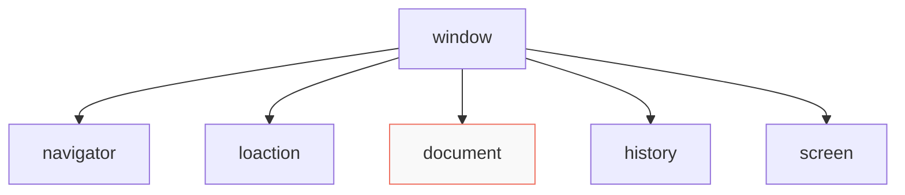
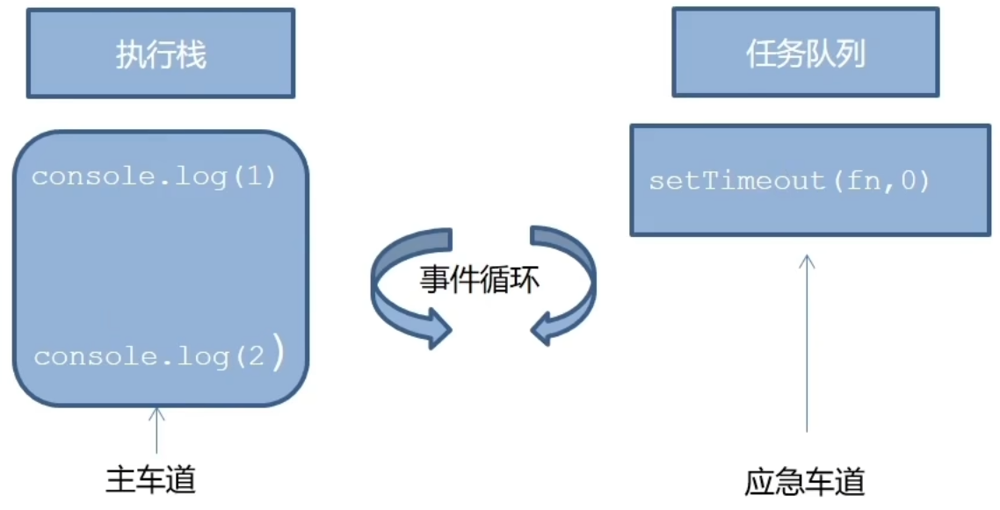

# 介绍

BOM，Browser Object Model，浏览器对象模型，整个浏览器都是 BOM。



- `window`对象是一个全局对象，也可以说是JavaScript中的顶级对象。
- 像`document`、`alert()`、`console.log()`这些都是`window`的属性，基本BOM的属性和方法都是`window`的。
- 所有通过`var`定义在全局作用域中的变量、函数都会变成`window`对象的属性和方法。
- `window`对象下的属性和方法调用的时候可以省略`window`。

# JS 的执行机制

JavaScript 语言的一大特点就是**单线程**，也就是说，**同一个时间只能做一件事**。

这是因为 Javascript 这门脚本语言诞生的使命所致——JavaScript 是为处理页面中用户的交互，以及操作 DOM 而诞生的。比如我们对某个 DOM 元素进行添加和删除操作，不能同时进行。应该先进行添加，之后再删除。

单线程就意味着，所有任务需要排队，前一个任务结束，才会执行后一个任务。这样导致如果 JS 执行的时间过长，这样就会造成页面的渲染不连贯，导致页面渲染加载阻塞的感觉。

```js
// 经典面试题
console.log(111);
setTimeout(() => {
    console.log(222);
}, 0);
console.log(333);
/*
执行：1.3.2
*/
```

# JS 的异步

## JS 中的同步与异步

JavaScript 是一门**单线程**语言，这意味着它在同一时刻只能做一件事。为了不让耗时的操作阻塞主线程（比如网络请求、定时器），它引入了异步机制。

- 同步（Synchronous）

  代码从上到下依次执行，前一行没执行完，后一行必须等着。

  - 例子：`console.log(1); console.log(2);` 永远先打印 1，再打印 2。

- 异步（Asynchronous）

  遇到耗时操作时，JS 不会干等，而是把它交给后台线程处理，自己继续往下执行。等耗时操作完成后，再把回调函数放回主线程执行。

  - 例子：`console.log(1); setTimeout(() => console.log(2), 1000); console.log(3);` 执行顺序是 1 -> 3 -> 2。

### 同步任务

同步任务都在主线程上执行，形成一个`执行栈`。

### 异步任务

JS 的异步是通过回调函数实现的。

一般而言，异步任务有以下三种类型：

1. 普通事件，如 `click`、`resize` 等。
2. 资源加载，如 `load`、`error` 等。
3. 定时器，包括 `setInterval`、`setTimeout` 等。

异步任务相关添加到`任务队列`中（任务队列也称为消息队列）。

## 异步管理

JS 的异步管理**内置于浏览器（或 Node.js）底层架构**。它的核心管理者叫做 **事件循环（Event Loop）**，工作流程如下：

1. 执行主线程（调用栈 Call Stack）

   同步代码在这里排队执行。

2. 移交后台线程

   遇到异步任务（如 `setTimeout`、`fetch`），主线程把它丢给浏览器的 Web APIs（如定时器模块、网络请求模块）去处理，主线程继续往下走。

3. 回调入队（任务队列 Task Queue）

   当后台线程处理完异步任务后，会把对应的回调函数放进“任务队列”里排队。

4. 循环检查

   Event Loop 会一直盯着“调用栈”（执行栈），一旦发现调用栈空了（即**同步代码执行完**了），它就会立刻从“任务队列”里拿出一个回调函数，扔进调用栈执行。如果再空了，就再看任务队列里面还有没有回调函数。这样循环的拿出，就构成了**事件循环**。



## 异步的实现方式

JS 的异步代码写法经历了三个阶段的进化。

### 回调函数（Callback）

这是最原始的方式。把函数作为参数传给异步任务，等任务完成后调用它。

如果异步任务需要嵌套，就会形成“回调地狱（Callback Hell）”，代码极难阅读和维护。

```javascript
getData(function(a) {
    getMoreData(a, function(b) {
        getEvenMoreData(b, function(c) {
            // 嵌套越来越深...
        });
    });
});
```

### Promise（承诺）

ES6 引入了 Promise，它代表一个异步操作的最终结果。它把嵌套的回调变成了线性的 `.then()` **链式调用**。

```javascript
getData()
    .then(a => getMoreData(a))
    .then(b => getEvenMoreData(b))
    .then(c => console.log(c))
    .catch(err => console.error(err)); // 统一处理错误
```

### async / await

它是建立在 Promise 之上的语法糖，可以用“同步的排版”来写异步代码，底层依然是 Event Loop 在管理。

```javascript
async function fetchData() {
    try {
        const a = await getData();
        const b = await getMoreData(a);
        const c = await getEvenMoreData(b);
        console.log(c);
    } catch (err) {
        console.error(err);
    }
}
```

## 对比

| 特性         | Python (`asyncio`)                       | JavaScript                                      |
| ------------ | ---------------------------------------- | ----------------------------------------------- |
| **异步模型** | 显式协程（Coroutine）                    | 隐式事件循环（Event Loop）                      |
| **触发方式** | 必须用 `async def` 定义，用 `await` 调用 | 原生支持回调，或用 `async/await` 语法糖         |
| **调度器**   | 需要手动运行 `asyncio.run()`             | 浏览器/Node.js 底层自动运行，开发者无感知       |
| **并发能力** | 适合 I/O 密集型任务                      | 同样适合 I/O 密集型，且天生为浏览器 UI 渲染服务 |

# `loaction` 对象

`location` 对象是浏览器对象模型（BOM）中非常重要的一个对象，它相当于浏览器的“地址栏管理器”，包含了当前页面的 URL 信息，并提供了一系列属性和方法来操作 URL、跳转页面或刷新页面。

## 实例化格式

`location` 对象是 `window` 对象的一个属性，通常不需要手动使用 `new` 关键字实例化，而是直接通过全局对象获取。

```javascript
window.location;  // 推荐写法：通过 window 对象获取，语义最清晰
location;         // 简写：作为全局变量直接使用（但需注意避免与局部变量命名冲突）
document.location; // 等价写法：通过 document 对象获取，效果相同
```

## 获取方式详解

| 获取方式            | 作用与说明                                                   |
| ------------------- | ------------------------------------------------------------ |
| `window.location`   | 最推荐的获取方式。<br />明确表示使用的是全局的 `window` 对象属性，代码可读性最好，不易产生歧义。 |
| `location`          | 简写形式。由于它是全局变量，可以直接使用。<br />但如果在函数内部定义了同名的局部变量 `location`，会覆盖全局对象，导致获取失败。 |
| `document.location` | 等价于 `window.location`。<br />`Document` 和 `Window` 接口都提供了对 `Location` 对象的访问入口。 |

## 常用属性

| 属性       | 作用与说明                                                   |
| ---------- | ------------------------------------------------------------ |
| `href`     | **获取或设置完整的 URL 字符串。**<br />修改该属性会直接跳转到新的 URL，这是最常用的跳转方式。 |
| `protocol` | 获取或设置 URL 的协议部分（如 `http:` 或 `https:`）。<br />注意返回值末尾包含冒号。 |
| `host`     | 获取或设置主机名和端口号（如 `www.example.com:8080`）。      |
| `hostname` | 获取或设置纯主机名（域名），不包含端口号（如 `www.example.com`）。 |
| `port`     | 获取或设置 URL 中的端口号。<br />如果使用的是默认端口（如 HTTP 的 80 或 HTTPS 的 443），则返回空字符串。 |
| `pathname` | 获取或设置 URL 的路径部分（以 `/` 开头，如 `/path/page.html`）。 |
| `search`   | 获取或设置 URL 的查询字符串部分（以 `?` 开头，如 `?id=123&name=test`）。<br />常用于获取 GET 请求的参数。 |
| `hash`     | 获取或设置 URL 的锚点部分（以 `#` 开头，如 `#section1`），常用于页面内导航。 |
| `origin`   | 只读属性。返回 URL 的源信息，包含协议、主机名和端口号（如 `https://www.example.com:8080`）。 |

## 常用方法

| 方法                  | 作用与说明                                                   |
| --------------------- | ------------------------------------------------------------ |
| `assign(url)`         | 加载新的文档。效果与直接设置 `location.href` 相同。<br />会在浏览器的历史记录中保留当前页面的访问记录，用户可以点击“后退”按钮返回。 |
| `replace(url)`        | 用新的文档替换当前文档。与 `assign` 不同的是，它**不会**在历史记录中保留当前页面，<br />用户无法通过“后退”按钮返回到被替换的页面<br />（常用于登录成功后的跳转，防止用户退回登录页重新提交）。 |
| `reload(forceReload)` | **重新加载当前页面**。如果不传参数或传入 `false`，浏览器可能会从缓存中加载；<br />如果传入 `true`，则会强制从服务器重新获取最新页面，忽略缓存。 |
| `toString()`          | 返回完整的 URL 字符串。<br />效果与读取 `location.href` 相同，但 `toString()` 不能用于修改 URL 的值。 |

# `navigator` 对象

在 JavaScript 中，`navigator` 对象包含了有关访问者浏览器和运行环境的大量信息。与常规类不同，它不需要手动实例化，而是作为 `window` 对象的只读属性直接提供。

## 获取格式

`navigator` 对象是全局可用的，可以通过以下两种方式获取：

```javascript
window.navigator; // 标准写法：通过 window 对象获取，语义最清晰
navigator;        // 简写：作为全局变量直接使用（推荐）
```

## 获取方式详解

| 获取方式           | 作用与说明                                                   |
| ------------------ | ------------------------------------------------------------ |
| `window.navigator` | 最严谨的获取方式。明确表明它是 `window` 对象的属性。         |
| `navigator`        | 简写形式。由于 `navigator` 是全局变量，在代码中可以直接调用。 |

## 常用属性

| 属性                  | 作用与说明                                                   |
| --------------------- | ------------------------------------------------------------ |
| `userAgent`           | 返回由浏览器发送到服务器的用户代理报头（user-agent header）字符串。<br />通常包含浏览器名称、版本及操作系统**信息**。 |
| `platform`            | 返回浏览器所在的操作系统平台（如 `"Win32"`, `"MacIntel"`, `"Linux x86_64"`）。 |
| `language`            | 返回浏览器的首选语言，通常为语言代码（如 `"zh-CN"`, `"en-US"`）。 |
| `languages`           | 返回一个字符串数组，表示用户的首选语言，按优先级排序。       |
| `cookieEnabled`       | 返回一个布尔值，如果浏览器启用了 Cookie 则返回 `true`，否则返回 `false`。 |
| `onLine`              | 返回一个布尔值，指示浏览器当前是否处于联网状态。             |
| `hardwareConcurrency` | 返回设备可用的逻辑处理器核心数量。                           |
| `deviceMemory`        | 返回设备内存的近似值（以 GB 为单位），通常向下取整到最接近的 2 的幂。 |
| `maxTouchPoints`      | 返回当前设备支持的最大同时触摸接触点数。                     |
| `geolocation`         | 返回一个 `Geolocation` 对象，用于访问设备的地理位置信息。    |
| `clipboard`           | 返回一个 `Clipboard` 对象，提供对系统剪贴板的读写访问权限（需在安全上下文中使用）。 |
| `mediaDevices`        | 返回一个 `MediaDevices` 对象，可用于获取摄像头、麦克风等媒体设备的访问权限。 |

## 常用方法

| 方法                        | 作用与说明                                                   |
| --------------------------- | ------------------------------------------------------------ |
| `javaEnabled()`             | 返回一个布尔值，指示浏览器是否支持并启用了 Java。            |
| `share(data)`               | 调用浏览器原生的分享机制，允许用户分享文本、链接或文件（需在安全上下文中使用）。 |
| `vibrate(pattern)`          | 使设备产生震动（如果支持）。参数可以是毫秒数或震动模式数组，常用于移动端。 |
| `sendBeacon(url, data)`     | 用于在页面卸载时，向服务器异步发送少量的数据（如分析统计或日志），不会阻塞页面关闭。 |
| `registerProtocolHandler()` | 允许网站将自身注册为特定协议（如 `mailto:` 或 `web+myapp:`）的处理程序。 |

## 核心避坑提示

在现代前端开发中，**强烈不建议**依赖 `navigator.userAgent` 或 `navigator.appName` 来判断浏览器类型或版本。因为这些字符串极易被用户或插件伪造（Spoofing），且不同浏览器可能使用相同的名称。现代开发更推崇**特性检测（Feature Detection）**，即直接判断某个 API 是否存在，而不是猜测浏览器是谁。

# `history`

在 JavaScript 中，`history` 对象用于操作浏览器的会话历史记录（即用户在当前标签页中访问过的页面）。与常规类不同，它不需要手动实例化，而是作为 `window` 对象的只读属性直接提供。

## 获取格式

`history` 对象是全局可用的，可以通过以下两种方式获取：

```javascript
window.history; // 标准写法：通过 window 对象获取，语义最清晰
history;        // 简写：作为全局变量直接使用（推荐）
```

## 获取方式详解

| 获取方式         | 作用与说明                                                  |
| ---------------- | ----------------------------------------------------------- |
| `window.history` | 最严谨的获取方式。明确表明它是 `window` 对象的属性。        |
| `history`        | 简写形式。由于 `history` 是全局变量，在代码中可以直接调用。 |

## 常用属性

| 属性                | 作用与说明                                                   |
| ------------------- | ------------------------------------------------------------ |
| `length`            | **只读属性**。<br />返回一个整数，表示会话历史中元素的数目，包括当前加载的页面。 |
| `state`             | **只读属性**。<br />返回历史堆栈顶部的状态值。这是一种不必等待 `popstate` 事件而查看当前状态的方式。 |
| `scrollRestoration` | 允许 Web 应用程序显式地设置默认滚动恢复行为。<br />`auto`（自动恢复滚动位置）、<br />`manual`（手动处理）。 |

## 常用方法

| 方法                              | 作用与说明                                                   |
| --------------------------------- | ------------------------------------------------------------ |
| `back()`                          | 转到浏览器会话历史的上一页，与用户单击浏览器的“后退”按钮行为相同。<br />等价于 `history.go(-1)`。 |
| `forward()`                       | 转到浏览器会话历史的下一页，与用户单击浏览器的“前进”按钮行为相同。<br />等价于 `history.go(1)`。 |
| `go(delta)`                       | 通过当前页面的相对位置从浏览器历史记录异步加载页面。<br />正数表示前进，负数表示后退（如 `-1` 为上一页）。<br />不传参或传 `0` 时，重新载入当前页面。 |
| `pushState(state, title, url)`    | 向会话历史栈中插入一条新记录。<br />`state` 为关联的状态对象（可序列化）；<br />`title` 目前被多数浏览器忽略；<br />`url` 为可选的新地址（必须同源）。<br />此方法不会触发页面刷新。 |
| `replaceState(state, title, url)` | 更新历史栈上最新的条目（替换当前记录，而不是新增）。<br />参数说明同 `pushState()`。<br />常用于更新当前页的状态或 URL，避免产生冗余的历史记录。 |

## 核心提示

调用 `pushState()` 或 `replaceState()` 虽然会改变地址栏的 URL，但**不会**触发页面刷新，也**不会**触发 `popstate` 事件。只有当用户点击浏览器的“前进”或“后退”按钮（或调用 `back()`、`forward()`、`go()`）导致历史栈指针移动时，才会派发 `popstate` 事件。因此，在单页应用（SPA）中，通常需要手动监听 `window.addEventListener('popstate', callback)` 来响应路由变化。

# 浏览器的存储

## 引言

### JS 普通变量

- 存储位置

  普通的 JS 变量（如 `let count = 0`）存储在浏览器的**运行内存（RAM）**中。

- 生命周期

  它的生命周期与“当前页面的 JS 执行环境”绑定。

- 刷新本质

  当点击刷新时，浏览器会**销毁**当前的执行环境，清空内存，然后重新下载并解析 HTML 和 JS 文件。因此，内存中的所有变量都会回到初始状态。

### 历史记录

- 存储位置

  历史记录存储在浏览器进程级别的**持久化存储**（如硬盘或受保护的内存区）中。

- 生命周期

  它的生命周期与“浏览器标签页（Tab）”绑定。只要标签页不关闭，无论页面怎么刷新、跳转，这段历史记录都会一直保留。

- 设计目的

  这是为了保障用户的导航体验，确保点击“后退”按钮时能回到上一个页面。

## 浏览器持久化存储机制

- `sessionStorage`（会话存储）

  - 特点

    数据仅在当前标签页有效。关闭标签页后数据自动销毁。

  - 场景

    适合存储表单草稿、单次会话的临时状态。

- `localStorage`（本地存储）

  - 特点

    数据永久保留，除非用户手动清除缓存或通过代码删除。

  - 场景

    适合存储用户偏好设置（如暗黑模式开关）、长期登录状态。

- **`Cookie`**

  - 特点

    容量极小（约 4KB），每次向服务器发请求时都会自动携带。

  - 场景

    传统上用于身份验证（Token），现在更多被 `localStorage` 替代。

- `IndexedDB`（本地数据库）

  - 特点

    浏览器内置的 NoSQL 数据库，支持存储大量结构化数据甚至文件。

  - 场景

    适合离线应用、缓存大量图片/视频、复杂的本地数据管理。

## 浏览器的刷新

在浏览器中，`F5`（普通刷新）和 `Ctrl + F5`（强制刷新）的核心区别在于它们**对浏览器缓存的处理机制不同**。简单来说，前者会“先问服务器有没有更新”，后者则是“直接无视缓存，重新下载一切”。

### F5（普通刷新）

- 缓存机制

  浏览器会跳过“强缓存”，但会启用“协商缓存”。

- 工作原理

  浏览器会向服务器发送一个请求，并带上缓存验证标识（如 `If-Modified-Since` 或 `If-None-Match`），询问服务器资源是否有更新。

- 服务器响应

  - 如果资源**没有更新**，服务器返回 `304 Not Modified`，浏览器继续使用本地缓存的内容。
  - 如果资源**已更新**，服务器返回 `200 OK` 和最新的文件内容，浏览器更新本地缓存。

- 特点

  加载速度相对较快，因为如果资源未变，不需要重新下载文件内容。

### Ctrl + F5（强制刷新）

- 缓存机制

  浏览器会**完全跳过**强缓存和协商缓存。

- 工作原理

  浏览器相当于给服务器下了“强制命令”，请求时会自动带上 `Cache-Control: no-cache, no-store` 等请求头，直接忽略本地所有缓存。

- 服务器响应

  服务器会直接返回 `200 OK` 以及最新的完整文件内容，浏览器下载并覆盖本地旧缓存。

- 特点

  确保用户看到的一定是服务器上的最新版本，但加载速度较慢，因为所有资源都需要重新下载。

### 总结对比

| 特性         | F5 (普通刷新)              | Ctrl + F5 (强制刷新)               |
| ------------ | -------------------------- | ---------------------------------- |
| **强缓存**   | 跳过                       | 跳过                               |
| **协商缓存** | **启用**（向服务器验证）   | **跳过**（完全忽略）               |
| **网络请求** | 发送验证请求，可能返回 304 | 强制请求最新资源，返回 200         |
| **加载速度** | 较快（可能复用本地缓存）   | 较慢（全量重新下载）               |
| **适用场景** | 日常浏览、常规调试         | 代码更新后、排查缓存导致的显示异常 |

> `F5` 是问服务器“文件变了吗？”，没变就用旧的；
>
> `Ctrl + F5` 是直接告诉服务器“别废话，把最新的文件给我”。

## 总结

| 数据类型       | 存储位置       | 刷新页面 | 关闭标签页 | 关闭浏览器 |
| -------------- | -------------- | -------- | ---------- | ---------- |
| 普通 JS 变量   | 运行内存       | ❌ 重置   | ❌ 重置     | ❌ 重置     |
| History 记录   | 浏览器进程存储 | ✅ 保留   | ❌ 清空     | ❌ 清空     |
| sessionStorage | 会话存储       | ✅ 保留   | ❌ 清空     | ❌ 清空     |
| localStorage   | 持久化存储     | ✅ 保留   | ✅ 保留     | ✅ 保留     |

# 本地存储

在 JavaScript 中，`localStorage` 是 Web Storage API 的一部分，用于在浏览器中进行本地持久化存储。与常规类不同，它不需要手动实例化，而是作为 `window` 对象的只读属性直接提供。

- 作用

  可以将数据永久存储在本地（用户的电脑），除非手动删除，否则关闭页面也会存在。

- 特性

  - 可以多窗口（页面）共享（同一浏览器可以共享）。
  - 以**键值对**的形式存储使用。

- 查看

  在 Application（应用程序）中查看。

## 获取格式

`localStorage` 对象是全局可用的，可以通过以下两种方式获取：

```javascript
window.localStorage; // 标准写法：通过 window 对象获取，语义最清晰
localStorage;        // 简写：作为全局变量直接使用（推荐）
```

## 获取方式详解

| 获取方式              | 作用与说明                                           |
| --------------------- | ---------------------------------------------------- |
| `window.localStorage` | 最严谨的获取方式。明确表明它是 `window` 对象的属性。 |
| `localStorage`        | 简写形式。由于它是全局变量，在代码中可以直接调用。   |

## 常用属性

| 属性     | 作用与说明                                                   |
| -------- | ------------------------------------------------------------ |
| `length` | **只读属性**。返回一个整数，表示当前存储在 `localStorage` 中的数据项（键值对）的数量。 |

## 常用方法

| 方法                  | 作用与说明                                                   |
| --------------------- | ------------------------------------------------------------ |
| `setItem(key, value)` | 将一个键值对添加到存储中。<br />如果键名已存在，则更新其对应的值。<br />注意：`value` 会被强制转换为字符串。 |
| `getItem(key)`        | 接受一个键名作为参数，返回该键名对应的值。如果键不存在，则返回 `null`。 |
| `removeItem(key)`     | 接受一个键名作为参数，从存储中删除该键值对。如果键不存在，则什么都不做。 |
| `clear()`             | 清空 `localStorage` 中的所有键值对。                         |
| `key(index)`          | 接受一个数字 `index` 作为参数，返回存储中第 `index` 个键的名称（索引从 0 开始）。<br />常用于遍历存储。 |

## 核心避坑提示

`localStorage` **只能存储字符串**。如果要存储对象或数组，必须在存入前使用 `JSON.stringify()` 进行序列化，在取出后使用 `JSON.parse()` 进行反序列化。直接存入对象会被隐式转换为 `[object Object]` 字符串，导致数据丢失。

> JavaScript 引擎会**自动且隐式地**调用该对象的 `toString()` 方法，试图将其转换为字符串。

# 会话存储

在 JavaScript 中，`sessionStorage` 是 Web Storage API 的一部分，用于在浏览器中进行会话级别的临时存储。与常规类不同，它不需要手动实例化，而是作为 `window` 对象的只读属性直接提供。

## 获取格式

`sessionStorage` 对象是全局可用的，可以通过以下两种方式获取：

```javascript
window.sessionStorage; // 标准写法：通过 window 对象获取，语义最清晰
sessionStorage;        // 简写：作为全局变量直接使用（推荐）
```

## 获取方式详解

| 获取方式                | 作用与说明                                           |
| ----------------------- | ---------------------------------------------------- |
| `window.sessionStorage` | 最严谨的获取方式。明确表明它是 `window` 对象的属性。 |
| `sessionStorage`        | 简写形式。由于它是全局变量，在代码中可以直接调用。   |

## 常用属性

| 属性     | 作用与说明                                                   |
| -------- | ------------------------------------------------------------ |
| `length` | **只读属性**。返回一个整数，表示当前存储在 `sessionStorage` 中的数据项（键值对）的数量。 |

## 常用方法

| 方法                  | 作用与说明                                                   |
| --------------------- | ------------------------------------------------------------ |
| `setItem(key, value)` | 将一个键值对添加到存储中。<br />如果键名已存在，则更新其对应的值。<br />注意：`value` 会被强制转换为字符串。 |
| `getItem(key)`        | 接受一个键名作为参数，返回该键名对应的值。如果键不存在，则返回 `null`。 |
| `removeItem(key)`     | 接受一个键名作为参数，从存储中删除该键值对。如果键不存在，则什么都不做。 |
| `clear()`             | 清空当前标签页下 `sessionStorage` 中的所有键值对。           |
| `key(index)`          | 接受一个数字 `index` 作为参数，返回存储中第 `index` 个键的名称（索引从 0 开始）。<br />常用于遍历存储。 |

------

## 核心避坑提示

1. 只能存储字符串

   如果要存储对象或数组，必须在存入前使用 `JSON.stringify()` 进行序列化，在取出后使用 `JSON.parse()` 进行反序列化。

2. 作用域隔离

   `sessionStorage` 的数据仅在当前浏览器标签页（Tab）内有效。即使在同一域名下打开多个标签页，它们之间的 `sessionStorage` 也是完全隔离的。当该标签页被关闭时，数据会被自动清除。

# JSON

在 JavaScript 中，`JSON` 是一个内置的全局对象，用于解析 JSON 字符串和将 JavaScript 对象转换为 JSON 字符串。与常规类不同，它不需要手动实例化，而是直接作为全局变量提供。

## 获取格式

`JSON` 对象是全局可用的，可以通过以下两种方式获取：

```javascript
window.JSON; // 标准写法：通过 window 对象获取，语义最清晰
JSON;        // 简写：作为全局变量直接使用（推荐）
```

## 获取方式详解

| 获取方式      | 作用与说明                                               |
| ------------- | -------------------------------------------------------- |
| `window.JSON` | 最严谨的获取方式。明确表明它是 `window` 对象的属性。     |
| `JSON`        | 简写形式。由于 `JSON` 是全局变量，在代码中可以直接调用。 |

## 常用属性

`JSON` 对象本身没有自定义的实例属性，它仅作为命名空间存在。

## 常用方法

| 方法                                | 作用与说明                                                   |
| ----------------------------------- | ------------------------------------------------------------ |
| `parse(text, reviver)`              | 将 JSON 字符串解析为 JavaScript 对象。<br />`text` 为要解析的 JSON 字符串；<br />`reviver` 为可选的转换函数，在解析时对每个键值对进行过滤或修改。<br />如果字符串格式不合法，会抛出语法错误。 |
| `stringify(value, replacer, space)` | 将 JavaScript 对象或值转换为 JSON 字符串。<br />`value` 为要序列化的值；<br />`replacer` 为可选的过滤器（数组或函数），用于过滤或修改结果；<br />`space` 为可选的格式化参数（数字或字符串），用于添加缩进以提高可读性。<br />`undefined`、函数和 `Symbol` 在序列化时会被忽略。 |

## 核心避坑提示

`JSON.parse()` 和 `JSON.stringify()` 在处理包含 `undefined`、函数或 `Symbol` 的数据时行为不同：

- 序列化时

  `JSON.stringify()` 会直接忽略值为 `undefined`、函数或 `Symbol` 的属性。

- 解析时

  `JSON.parse()` 遇到不合法的 JSON 字符串（如包含单引号、末尾多余逗号等）会直接报错。在生产环境中，建议始终使用 `try...catch` 语句包裹 `JSON.parse()` 以捕获潜在的解析异常。

## 代码示例

### 反序列化

`reviver` 是一个转换函数，它会在解析过程中遍历每一个键值对，在最终结果返回前对数据进行过滤或修改。

```javascript
const jsonStr = '{"name": "Alice", "age": "25", "password": "123456"}';

// reviver 函数接收 key 和 value 两个参数
const user = JSON.parse(jsonStr, (key, value) => {
  // 过滤掉敏感字段：如果键名是 password，直接返回 undefined 将其丢弃
  if (key === 'password') {
    return undefined; 
  }
  
  // 类型转换：将 age 从字符串转换为数字类型
  if (key === 'age') {
    return Number(value); 
  }
  
  // 其他字段原样返回
  return value; 
});

console.log(user); 
// 输出: { name: 'Alice', age: 25 } 
// password 被过滤了，age 变成了数字 25
```

### 序列化

`replacer` 可以用来过滤或转换属性，而 `space` 则是为了让输出的 JSON 字符串变得美观易读。

```javascript
const user = {
  id: 101,
  name: "Bob",
  age: 30,
  password: "secret"
};

// 1. 使用 replacer（数组形式）：只保留数组中列出的属性
// 2. 使用 space（数字形式）：每个层级缩进 2 个空格
const jsonStr1 = JSON.stringify(user, ["name", "age"], 2);
console.log(jsonStr1);
/* 输出:
{
  "name": "Bob",
  "age": 30
}
*/

// 1. 使用 replacer（函数形式）：对所有值进行统一处理
// 2. 使用 space（字符串形式）：使用制表符进行缩进
const jsonStr2 = JSON.stringify(user, (key, value) => {
  // 将所有字符串类型的值转换为大写
  return typeof value === 'string' ? value.toUpperCase() : value;
}, "\t");

console.log(jsonStr2);
/* 输出:
{
	"id": 101,
	"name": "BOB",
	"age": 30,
	"password": "SECRET"
}
*/
```

- `reviver`

  在“字符串变对象”时，用来**清洗**或**转换**数据。

- `replacer`

  在“对象变字符串”时，用来**筛选**或**转换**数据。

- `space`

  纯粹为了格式化输出，方便人类阅读或调试。

### 回调函数返回值

无论是 `JSON.parse` 的 `reviver`，还是 `JSON.stringify` 的 `replacer`，它们在遍历对象时，都会根据回调函数的**返回值**来决定这个属性最终的命运。

#### 返回 `undefined`（触发过滤）

如果在回调函数中返回了 `undefined`，序列化/解析引擎会认为这个属性是“不需要的”。

- 在 `stringify` 中

  该属性会被**直接丢弃**，不会出现在最终的 JSON 字符串中。

- 在 `parse` 中

  该属性会被**删除**，不会出现在最终生成的 JavaScript 对象中。

#### 返回其他任何值（触发修改或保留）

如果你返回了具体的值，引擎就会用这个返回值**替换**掉原来的值。

- 如果返回的值和原值一样，相当于**保留**。
- 如果返回了新的值（比如把字符串转成了数字），相当于**修改**。

#### 机制：`delete` 操作符

在 JavaScript 引擎的底层实现中，当它发现回调函数返回了 `undefined` 时，它实际上等同于对当前对象执行了 `delete obj[key]` 操作。

我们可以通过一个简单的代码来验证这个机制：

```javascript
const user = {
  name: "Alice",
  age: 25,
  password: "123456"
};

// 我们手动模拟一下引擎的过滤逻辑
for (const key in user) {
  // 假设我们的规则是：遇到 password 就过滤掉
  if (key === "password") {
    // 引擎内部遇到 undefined 返回值时，实际执行的就是类似这样的操作
    delete user[key]; 
  }
}

console.log(user); 
// 输出: { name: 'Alice', age: 25 }
// password 属性被彻底从对象中删除了
```

回调函数返回 `undefined`，就等于告诉引擎：“请把这个属性删掉（过滤掉）”。

这是 JSON API 在设计上提供的一种非常巧妙的数据清洗机制。
