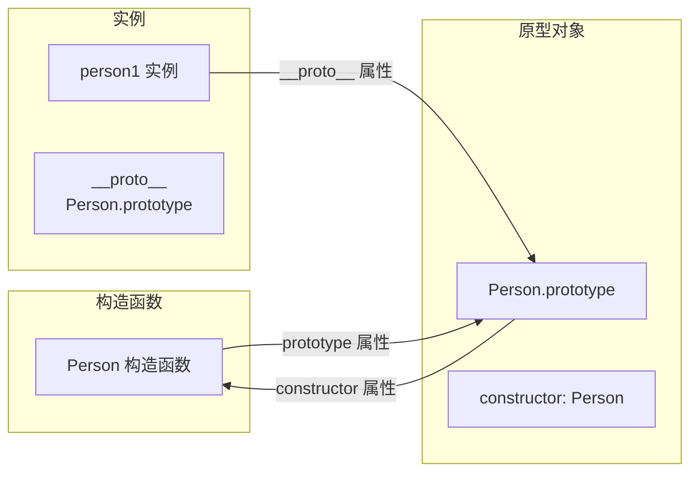
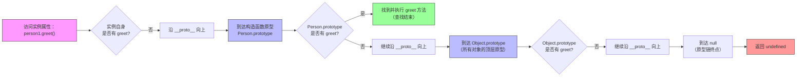

# 创建对象的方式

在 JavaScript 中，创建对象的方式多种多样，涵盖了从基础的语法糖到经典的面向对象设计模式。

## 对象字面量

（Object Literal）

- 定义

  使用花括号 `{}` 直接定义对象的属性和方法。

- 特点

  语法最简洁、直观。适合创建单个、结构固定的简单对象（如配置项）。

- 局限

  码复用性差。如果需要创建多个结构相似的对象，会导致大量重复代码。

## 工厂模式

（Factory Pattern）

- 定义

  封装一个函数，在函数内部创建对象并返回。

- 特点

  解决了对象字面量的代码复用问题，封装了创建逻辑。

- 局限

  无法识别对象的类型（使用 `instanceof` 检查时，所有对象都指向 `Object`），且每个实例的方法都会重新创建，造成内存浪费。

## 构造函数模式

（Constructor Function）

- 定义

  定义一个首字母大写的函数，通过 `new` 关键字调用，利用 `this` 为实例绑定属性。

- 特点

  可以通过 `instanceof` 准确识别对象类型；支持原型继承。

- 局限

  如果在构造函数内部定义方法，每个实例都会创建一份独立的方法副本，导致内存浪费。

## 原型模式

（Prototype Pattern）

- 定义

  将属性和方法直接挂载到构造函数的 `prototype` 属性上。

- 特点

  所有实例共享原型上的方法，极大地节省了内存。

- 局限

  原型上的属性会被所有实例共享。如果原型属性是引用类型（如数组），修改一个实例的属性会影响所有其他实例。

## 组合模式

（构造函数 + 原型）

- 定义

  将实例属性放在构造函数中定义，将共享的方法放在原型上定义。

- 特点

  结合了构造函数和原型模式的优点，既保证了实例属性的独立性，又实现了方法的共享。这是 ES6 之前最主流、最健壮的创建对象方式。

## Class 语法

- 定义

  使用 `class` 关键字定义类，通过 `constructor` 初始化属性，直接在类体中定义方法。

- 特点

  语法更接近传统面向对象语言（如 Java、C++），代码结构清晰，语义明确。

- 本质

  Class 仅仅是 JavaScript 原型继承的语法糖，底层依然基于原型链机制。

## Object.create()

- 定义

  使用 `Object.create(proto)` 指定一个对象作为新对象的原型。

- 特点

  提供了一种更灵活的继承方式，无需定义构造函数即可实现对象间的原型关联。

- 局限

  语法相对繁琐，且需要手动初始化实例属性。

## 核心方式对比总结

| 创建方式         | 核心优势                     | 核心局限                 | 适用场景               |
| ---------------- | ---------------------------- | ------------------------ | ---------------------- |
| **对象字面量**   | 简单直观，代码量少           | 无法复用，不适合批量创建 | 单例对象、配置对象     |
| **工厂模式**     | 封装创建逻辑，解决复用问题   | 无法识别对象类型         | 需要隐藏具体创建细节时 |
| **构造函数模式** | 支持类型识别，支持继承       | 方法无法共享，内存浪费   | 需要明确类型标识的场景 |
| **组合模式**     | 属性独立，方法共享，最稳健   | 代码结构稍显分散         | ES5 时代的通用对象创建 |
| **ES6 Class**    | 语法优雅，结构清晰，易于理解 | 本质仍是语法糖           | 现代前端项目、团队开发 |

# 构造函数

## 定义与本质

构造函数（Constructor）是 JavaScript 中一种用于创建和初始化对象实例的特殊函数。其本质是一个普通的函数，但通过配合 `new` 关键字调用时，便充当了对象的“蓝图”或“模板”。按照开发约定，构造函数的命名通常首字母大写，以区别于普通函数。

## 核心作用

- 批量创建对象

  解决对象字面量创建多个相似对象时产生的大量重复代码问题。

- 封装初始化逻辑

  将对象的属性赋值和初始状态设置封装在函数内部，使代码结构更清晰、易于维护。

- 支持类型识别

  通过构造函数创建的对象，可以使用 `instanceof` 操作符准确判断其所属的类型。

- 实现继承机制

  构造函数拥有 `prototype` 属性，是 JavaScript 实现原型链继承的基础。

## 内部机制

当使用 `new` 关键字调用构造函数时，JavaScript 引擎会在后台自动执行以下四个步骤：

1. 在内存中创建一个全新的空对象。
2. 将这个新对象的原型（`__proto__`）指向构造函数的 `prototype` 属性。
3. 将构造函数内部的 `this` 绑定到这个新对象上，并执行函数体内的代码（通常为 `this` 添加属性和方法）。
4. 如果构造函数没有显式返回一个对象，则自动返回这个新创建的对象；如果显式返回了一个非原始值（对象），则返回该对象。

## 基础语法格式

```javascript
function ConstructorName(param1, param2) {
  // param1：用于初始化对象属性的参数。
  // param2：用于初始化对象属性的参数。
  this.property1 = param1; // 为实例添加独有属性。
  this.property2 = param2; // 为实例添加独有属性。
}

// 静态属性
ConstructorName.property1 = ...;
// 静态方法
ConstructorName.method1 = ...;

const instance = new ConstructorName(value1, value2);
// new：触发构造函数机制的关键字。
// ConstructorName：构造函数的名称。
// value1, value2：传递给构造函数的实际参数。
// instance：最终创建出来的对象实例。
```

## 参数与返回值

| 语法成分      | 作用描述                               | 规则与可选值                                                 |
| ------------- | -------------------------------------- | ------------------------------------------------------------ |
| 构造参数      | 接收外部传入的值，用于初始化实例属性。 | 可以是任意数据类型（字符串、数字、对象、函数等）。           |
| `this` 关键字 | 指向当前正在被创建的新对象实例。       | 仅在配合 `new` 调用时有效；<br />直接调用会导致 `this` 指向全局对象或 `undefined`。 |
| 返回值        | 决定 `new` 表达式的最终结果。          | 默认隐式返回新对象。<br />若显式返回对象，则覆盖默认对象；若返回原始值，则被忽略。 |

## 注意事项

- 方法挂载到原型

  为了避免每个实例都创建一份独立的方法副本（造成内存浪费），应将共享的方法定义在构造函数的 `prototype` 属性上。

- 避免使用箭头函数

  箭头函数没有自己的 `this` 绑定，无法作为构造函数使用。若使用 `new` 调用箭头函数，会抛出 `TypeError` 错误。

- 严格模式

  建议在构造函数内部使用严格模式（`'use strict'`），以防止因忘记写 `new` 而导致意外修改全局对象。

- ES6 Class 语法

  现代 JavaScript 提供了 `class` 语法糖，其底层依然基于构造函数和原型链，但提供了更清晰、更接近传统面向对象语言的声明方式。

## 代码示例

```javascript
// 定义一个 Person 构造函数
function Person(name, age) {
  this.name = name; // 初始化姓名属性。
  this.age = age; // 初始化年龄属性。
}

// 将共享方法挂载到原型上，节省内存
Person.prototype.greet = function() {
  return `Hello, my name is ${this.name}`; // 返回问候语。
};

// 使用 new 关键字创建实例
const person1 = new Person('Alice', 30); 
const person2 = new Person('Bob', 25); 

console.log(person1.greet()); // 输出: Hello, my name is Alice
console.log(person2 instanceof Person); // 输出: true，验证类型
```

# class 语法

`class` 是 JavaScript 中用于定义类的关键字，本质上是基于原型链（Prototype Chain）继承的语法糖。它提供了一种更清晰、更接近传统面向对象语言（如 Java、Python）的语法来创建对象和处理继承。

## 语法格式

```javascript
class ClassName {
    // 1. 构造函数：用于初始化新创建的对象实例。
    constructor(param1, param2) {
        // **实例成员**
        this.property1 = param1; // 为实例添加独有属性。
        this.property2 = param2; // 为实例添加独有属性。
    }

    // 2. 实例方法：定义在原型上，供所有实例共享。
    methodName() {
        return `Value: ${this.property1}`; // 通过 this 访问实例属性。
    }

    // 3. **静态成员**：属于类本身，不属于实例，通常用于工具函数或常量。
    static staticMethod() {
        return 'This is a static method'; // 只能通过类名直接调用。
    }

    // 4. 私有字段（ES2022+）：使用 # 前缀，仅在类内部可访问。
    // 没有 static，即为实例属性
    #privateField = 'secret'; // 外部无法读取或修改。

    // 5. 访问器（Getter/Setter）：拦截属性的读取和赋值行为。
    get info() {
        return this.#privateField; // 读取私有字段。
    }

    // 访问器（Setter）：拦截属性的赋值行为，通常用于数据校验或联动更新。
    set info(value) {
        this.property1 = value; // 将传入的值赋给实例属性。
    }
}
```

## 语法成分详解

| 语法成分    | 作用描述                                  | 数据类型要求与规则                            |
| ----------- | ----------------------------------------- | --------------------------------------------- |
| ClassName   | 类的名称，遵循大驼峰命名规范。            | 合法的 JavaScript 标识符。                    |
| constructor | 类的默认构造方法，使用 `new` 时自动调用。 | 一个类最多只能有一个构造函数。                |
| 实例方法    | 定义对象的行为逻辑。                      | 自动挂载到类的 `prototype` 上。               |
| static      | 定义静态属性或静态方法。                  | 只能通过 `ClassName.xxx` 访问，实例无法调用。 |
| #fieldName  | 声明私有字段，实现真正的封装。            | 必须在类体内部预先声明，不能动态添加。        |
| get / set   | 定义属性的取值函数和存值函数。            | 调用时像普通属性一样使用（如 `obj.info`）。   |

## 变体与修饰符

| 变体/修饰符 | 说明                                                         |
| ----------- | ------------------------------------------------------------ |
| extends     | 用于创建子类，继承父类的属性和方法。                         |
| super       | 在子类构造函数中必须首先调用 `super()`，以执行父类的初始化逻辑；也可用于调用父类的方法。 |
| 类表达式    | 类可以通过表达式定义（如 `const MyClass = class {}`），支持匿名或命名，且不会被提升（Hoisting）。 |

## 常见配套语法与行为影响

| 配套语法              | 行为影响                                         |
| --------------------- | ------------------------------------------------ |
| new                   | 触发类的实例化过程，创建一个新的对象实例。       |
| instanceof            | 用于检查一个对象是否是特定类（或其子类）的实例。 |
| Object.getPrototypeOf | 用于获取类的原型对象，验证底层的原型链结构。     |

## 代码示例

```javascript
class Animal {
  constructor(name) {
    this.name = name; // 初始化动物名称。
  }

  speak() {
    return `${this.name} makes a noise.`; // 定义通用发声方法。
  }
}

class Dog extends Animal {
  constructor(name, breed) {
    super(name); // 调用父类构造函数，初始化 name。
    this.breed = breed; // 初始化狗的品种。
  }

  speak() {
    return `${this.name} barks.`; // 重写（Override）父类的 speak 方法。
  }
}

const dog = new Dog('Rex', 'Husky'); // 创建 Dog 实例。
console.log(dog.speak()); // 输出: Rex barks.
console.log(dog instanceof Animal); // 输出: true，验证继承关系。
```

# 私有属性

在 JavaScript 中，构造函数（Constructor Function）本身**没有**像 `class` 语法那样原生的 `get`、`set` 和 `#` 私有字段语法。这些关键字是 ES6 `class` 语法糖的一部分。

不过，由于 `class` 底层依然是基于原型链和构造函数的，因此完全可以通过传统的原型链操作和 ES5 的 API 在构造函数中实现相同的功能。

## 构造函数中的 Getter 和 Setter

在构造函数中，无法直接在函数体内使用 `get` 或 `set` 关键字。必须通过 `Object.defineProperty()` 方法，将访问器属性定义在构造函数的 `prototype` 上。

```javascript
function User(name) {
  this._name = name; // 使用下划线约定表示“伪私有”属性
}

// 在原型上定义 Getter 和 Setter
Object.defineProperty(User.prototype, 'name', {
  get() {
    return this._name; // 拦截读取行为
  },
  set(value) {
    if (typeof value !== 'string') {
      throw new Error('Name must be a string'); // 拦截赋值行为并进行校验
    }
    this._name = value;
  },
  configurable: true, // 允许后续修改或删除该属性描述符
  enumerable: true // 允许在 for...in 循环中枚举
});
```

## 构造函数中的私有属性

JavaScript 的构造函数没有原生的 `#` 私有字段语法。在 ES6 `class` 引入 `#` 之前，构造函数实现私有属性主要依靠以下两种方式：

### 闭包

利用函数作用域，将变量声明在构造函数内部，但不挂载到 `this` 上。外部无法访问，只有构造函数内部的方法可以访问。

```javascript
function BankAccount(initialBalance) {
  let balance = initialBalance; // 真正的私有变量，外部无法访问

  this.getBalance = function() {
    return balance; // 通过闭包访问私有变量
  };

  this.deposit = function(amount) {
    balance += amount; // 通过闭包修改私有变量
  };
}
```

### 命名约定（伪私有）

使用下划线前缀（`_propertyName`）来标记该属性为“内部使用，请勿外部访问”。这仅仅是一种团队约定，实际上外部依然可以访问和修改。

```javascript
function Config() {
  this._apiKey = 'secret-key'; // 伪私有属性，仅靠约定保护
}
```

## 核心区别总结

| 特性                | Class 语法                            | 构造函数（传统写法）                                   |
| ------------------- | ------------------------------------- | ------------------------------------------------------ |
| **Getter / Setter** | 直接在类体中使用 `get` / `set` 关键字 | 必须使用 `Object.defineProperty()` 挂载到原型上        |
| **私有字段**        | 使用 `#` 前缀，引擎级别强制私有       | 无原生语法。需使用闭包（真私有）或下划线约定（伪私有） |
| **静态私有字段**    | 使用 `static #fieldName`              | 无原生语法。需使用模块作用域或闭包模拟                 |

`get`、`set` 和 `#` 是 `class` 语法的专属特性。如果必须使用构造函数，需要通过 `Object.defineProperty()` 和闭包等底层机制来手动实现相同的效果。

# 内置构造函数

## 介绍

JavaScript 中的内置构造函数是语言标准预先定义好的一系列特殊函数，用于创建和初始化特定类型的对象实例。它们通过配合 `new` 关键字调用，能够根据传入的参数快速生成具备特定属性和方法的对象。当需要处理日期时间、匹配复杂字符串、管理异步操作或创建键值对集合等场景时，使用对应的内置构造函数是最标准且高效的做法。

## 常用构造函数

以下是 JavaScript 中常用的内置构造函数整理，涵盖了基础数据类型、集合、日期正则以及异步处理等核心领域。

### 基础与集合类

| 构造函数    | 核心作用           | 典型用法与参数说明                                           |
| ----------- | ------------------ | ------------------------------------------------------------ |
| **Object**  | 创建普通对象       | `new Object()` 或 `new Object({ key: 'value' })`。<br />通常推荐使用对象字面量 `{}` 替代。 |
| **Array**   | 创建数组           | `new Array(1, 2, 3)` 创建包含元素的数组；`new Array(5)` 创建长度为 5 的空数组。<br />通常推荐使用数组字面量 `[]` 替代。 |
| **Map**     | 创建键值对集合     | `new Map()`。支持任意类型的键（包括对象），按插入顺序迭代。<br />常用方法：`set()`，`get()`，`has()`。 |
| **Set**     | 创建唯一值集合     | `new Set([1, 2, 3, 3])`。自动去除重复值。<br />常用方法：`add()`, `has()`, `delete()`。 |
| **WeakMap** | 创建弱引用键值对   | `new WeakMap()`。键必须是对象，且为弱引用（不阻止垃圾回收）。<br />常用于存储对象的私有数据或元数据。 |
| **WeakSet** | 创建弱引用对象集合 | `new WeakSet()`。值必须是对象，且为弱引用。常用于追踪对象是否被处理过。 |

### 日期、正则与错误处理

| 构造函数   | 核心作用       | 典型用法与参数说明                                           |
| ---------- | -------------- | ------------------------------------------------------------ |
| **Date**   | 处理日期与时间 | `new Date()` 获取当前时间；<br />`new Date('2024-01-01')` 解析特定日期；<br />`new Date(timestamp)` 根据时间戳创建。 |
| **RegExp** | 创建正则表达式 | `new RegExp('pattern', 'flags')`。例如 `new RegExp('\\d+', 'g')`。<br />通常推荐使用正则字面量 `/pattern/flags` 替代。 |
| **Error**  | 创建错误对象   | `new Error('错误信息')`。用于手动抛出异常。<br />子类包括 `TypeError`，`RangeError`，`SyntaxError` 等。 |

### 异步与结构化数据

| 构造函数        | 核心作用           | 典型用法与参数说明                                           |
| --------------- | ------------------ | ------------------------------------------------------------ |
| **Promise**     | 处理异步操作       | `new Promise((resolve, reject) => { ... })`。<br />接收一个执行器函数，内部通过 `resolve` 成功或 `reject` 失败来改变状态。 |
| **ArrayBuffer** | 创建二进制缓冲区   | `new ArrayBuffer(length)`。<br />创建指定字节长度的固定长度二进制数据缓冲区，常用于处理文件流或网络数据。 |
| **DataView**    | 操作二进制数据视图 | `new DataView(buffer)`。<br />提供在 `ArrayBuffer` 上读写多种数字类型（如 Int8, Float32）的接口。 |

### 包装对象

> （不推荐直接使用）。

| 构造函数    | 核心作用       | 典型用法与注意事项                                           |
| ----------- | -------------- | ------------------------------------------------------------ |
| **String**  | 创建字符串对象 | `new String('text')`。返回的是对象而非原始字符串，容易导致类型判断错误。<br />推荐使用字面量 `'text'`。 |
| **Number**  | 创建数字对象   | `new Number(42)`。返回的是对象而非原始数字。<br />推荐使用字面量 `42` 或 `Number()` 函数进行类型转换。 |
| **Boolean** | 创建布尔对象   | `new Boolean(false)`。<br />注意：`new Boolean(false)` 创建的是对象，其布尔值为 `true`。<br />推荐使用字面量 `false`。 |

# Object 对象

`Object` 是 JavaScript 中所有对象的基类（根对象），它既是用于创建普通对象的构造函数，也是提供了一系列核心静态方法的工具集合。当需要动态创建对象、合并多个对象、将对象转换为键值对数组，或者精确控制对象属性的行为（如是否可枚举、是否可修改）时，`Object` 是最基础且不可或缺的工具。

## 实例化格式

```javascript
const obj = new Object(value);
// new：触发构造函数机制的关键字，启动对象创建流程。
// value：用于初始化对象的值。如果传入原始值（如字符串、数字），会将其转换为对应的包装对象；如果传入对象，则直接返回该对象；如果不传或传入 null/undefined，则创建一个空对象。
// obj：最终创建并返回的对象实例。
```

## 参数详解

| 参数名称 | 作用描述                 | 可选值或数据类型                                             |
| -------- | ------------------------ | ------------------------------------------------------------ |
| `value`  | 指定要创建的对象初始值。 | 任意数据类型（包括 undefined, null, 字符串, 数字, 布尔值, 对象等）。 |

## 常用静态方法

| 方法名称                            | 作用描述                                                     |
| ----------------------------------- | ------------------------------------------------------------ |
| `Object.keys(obj)`                  | 返回一个由对象自身可枚举属性名组成的数组。                   |
| `Object.values(obj)`                | 返回一个由对象自身可枚举属性值组成的数组。                   |
| `Object.entries(obj)`               | 返回一个由对象自身可枚举属性的 `[key, value]` 键值对数组。   |
| `Object.assign(target, ...sources)` | 将一个或多个源对象的可枚举属性复制到目标对象，并返回目标对象（常用于对象浅拷贝或合并）。 |
| `Object.freeze(obj)`                | 冻结对象，使其属性不可修改、不可添加、不可删除。             |
| `Object.create(proto)`              | 创建一个新对象，并使用指定的对象（参数）作为新对象的原型。   |

## 常用实例属性与方法

| 属性/方法名称          | 作用描述                                                     |
| ---------------------- | ------------------------------------------------------------ |
| `constructor`          | 指向创建该对象实例的构造函数（即 `Object`）。                |
| `__proto__`            | 指向该对象的原型对象（非标准属性，现代开发推荐使用 `Object.getPrototypeOf()`）。 |
| `hasOwnProperty(prop)` | 判断对象自身是否包含指定的属性（不检查原型链）。             |
| `toString()`           | 返回对象的字符串表示形式（默认为 `"[object Object]"`）。     |
| `valueOf()`            | 返回对象的原始值（对于普通对象，通常返回对象本身）。         |

# 原型

## 定义

原型（Prototype）是 JavaScript 实现面向对象编程（特别是继承和属性共享）的底层核心机制。JavaScript 是一门基于“原型链”的语言，而非传统的基于“类”（Class）的语言。在 JavaScript 中，每个对象在创建时都会关联一个内部属性 `[[Prototype]]`，该属性指向另一个对象，这个被指向的对象即为当前对象的“原型”。

## 作用

1. 实现属性与方法的共享（节省内存）

   通过将通用方法定义在原型对象上，所有由该构造函数创建的实例都能访问这些方法，而无需在每个实例中重复创建，从而极大地节省了内存空间。

2. 实现继承机制

   对象可以通过原型链向上查找属性和方法。子类对象可以通过设置自身的原型指向父类对象，从而获得父类的属性和方法，实现面向对象编程中的继承。

   ```js
   // 1. 定义父类
   function Animal(name) {
     this.name = name;
   }
   Animal.prototype.speak = function() {
     return `${this.name} makes a sound.`;
   };
   
   // 2. 定义子类
   function Dog(name, breed) {
     Animal.call(this, name); // 继承父类的实例属性
     this.breed = breed;
   }
   
   // 3. 核心：将子类的原型指向父类的实例（或原型对象）
   Dog.prototype = Object.create(Animal.prototype);
   Dog.prototype.constructor = Dog; // 修复 constructor 指向
   
   // 4. 子类添加自己的方法
   Dog.prototype.bark = function() {
     return `${this.name} barks!`;
   };
   
   // 5. 验证继承
   const dog = new Dog('Rex', 'Husky');
   console.log(dog.speak()); // 输出: Rex makes a sound. (继承自父类)
   console.log(dog.bark());  // 输出: Rex barks! (子类自身方法)
   ```

3. 属性查找的委托机制

   当访问一个对象的属性或方法时，如果对象自身不存在该属性，JavaScript 引擎会沿着原型链逐级向上查找，直到找到该属性或到达原型链的顶端（`null`）为止。

## 表现形式

1. 显式原型（`prototype`）

   这是**函数**（特别是构造函数）独有的属性。当定义一个函数时，JavaScript 引擎会自动为其创建一个 `prototype` 对象。它的主要作用是作为通过 `new` 关键字创建的新实例的原型模板。

2. 隐式原型（`__proto__`）

   这是**所有对象**（包括实例对象、原型对象本身）都拥有的内部属性。在现代浏览器中，该属性暴露为 `__proto__`。它指向创建当前对象的构造函数的 `prototype`，也可以就把它理解成是 `构造函数.prototype`。
   
   *vs code 没有提示。有些浏览器也用 `[[prototype]]` 表示。*

## 访问规范

- 标准访问方式

  在现代 JavaScript 开发中，推荐使用 `Object.getPrototypeOf(obj)` 获取对象的原型，使用 `Object.setPrototypeOf(obj, proto)` 设置对象的原型。

- 非标准访问方式

  `__proto__` 属性虽然被广泛支持，但已被视为过时且不推荐在现代代码中直接使用，主要用于调试或兼容旧代码。

- 创建指定原型的对象

  使用 `Object.create(proto)` 方法，可以创建一个新对象，并直接指定该新对象的原型为传入的 `proto` 对象。

## 构造函数、实例与原型的关系

- **构造函数**拥有一个 `prototype` 属性，指向其原型对象。
- **实例对象**通过内部的 （即 `__proto__`）指向构造函数的``prototype` 对象。
- **原型对象**拥有一个 `constructor` 属性，指回其对应的构造函数。

这三者构成了一个三角闭环关系：`实例.__proto__ === 构造函数.prototype`，且 `构造函数.prototype.constructor === 构造函数`。



## 原型链

1. 定义

   原型链（Prototype Chain）是多个对象通过属性串联起来的引用链。这条链从对象本身开始，一直延伸到 `null`。

2. 终点

   `Object.prototype` 是所有对象的顶层原型，而 `Object.prototype.__proto__` 的值为 `null`，标志着原型链的终结。

3. 查找规则

   属性查找遵循“就近原则”。优先查找对象自身属性；若未找到，则沿 `__proto__` 向上遍历原型链；若遍历至 `null` 仍未找到，则返回 `undefined`。




## 代码示例

```javascript
// 1. 定义构造函数
function Person(name) {
  this.name = name; // 实例属性，每个实例独有
}

// 2. 在显式原型上添加共享方法
Person.prototype.greet = function() {
  return `Hello, my name is ${this.name}`;
};

// 3. 创建实例
const person1 = new Person('Alice');

// 4. 原型链查找过程
console.log(person1.greet()); // 输出: Hello, my name is Alice
// 查找过程：
// 1. 引擎在 person1 自身寻找 greet 方法 -> 未找到
// 2. 引擎沿着 person1.__proto__ (即 Person.prototype) 寻找 -> 找到了 greet 方法

// 5. 验证原型关系
console.log(person1.__proto__ === Person.prototype); // 输出: true

// 6. 标准原型访问方式
console.log(Object.getPrototypeOf(person1) === Person.prototype); // 输出: true
```