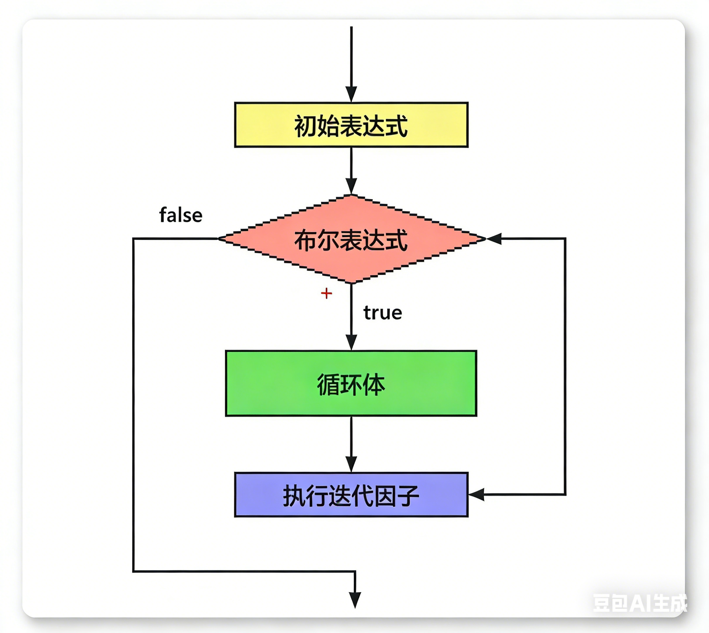

| 特征       | 属性 (Property)               | 方法 (Method)         | 独立函数 (Function)     |
| ---------- | ----------------------------- | --------------------- | :---------------------- |
| 语法样子   | `obj.name`                    | `obj.doSomething()`   | `doSomething(obj)`      |
| 括号 `()`  | ❌ 绝对没有                    | ✅ 必须有              | ✅ 必须有                |
| 位置       | 在变量后面                    | 在变量后面            | 变量在里面 (作为参数)   |
| 直觉理解   | “它是什么？” (状态)           | “它做什么？” (动作)   | “用什么处理它？” (工具) |
| 返回值     | 直接就是值 (如数字、字符串)   | 执行后返回一个新值    | 执行后返回一个新值      |
| 侧边栏提示 | 通常显示为 🟦 (Field/Property) | 通常显示为 🟪 (Method) | 通常显示为 🟨 (Function) |

---

以“;”代表结束。

字符串之间、字符串与数值之间都可以用 + 连接。

---

# 打印

```js
console.log();
docunment.write();
```

# 比较运算：

​	==：相等（只比较值）

​	===：严格相等（比较值和类）

# 布尔运算：

​	!：反

​	&&：且

​	||：或

​	boolean：布尔值

---

# if 语句：

```js
if (boolean) {
	...
} else if (boolean) {
	...
} else {
	...
};
```

---

# switch语句

```js
switch (parameter) {
	case condition1: // 匹配参数的条件，只用写值
		...
		break;		// 匹配只发生一次，必须使用break跳出
	case condition2: // 如果不使用break，程序会继续往下运行
		...
		break;
	default: // 当没有匹配时，默认的执行
		...
};
```

---

# 三目运算

三目运算可以看成是if...else..的简写。

```js
var 变量 = condition ? 结果1 : 结果2
```

三目运算也是一种运算方式，因此它会返回值，可以用一个变量去接收。`condition`为真返回结果1，否则返回结果2。

```js
var num = 10
var result = num % 2 == 0 ? '偶数' : '奇数'
console.log(result) // 输出偶数
```

类似的：

```js
var x = 结果1 | 结果2
```

如果结果1为`undefined`或者`null`就返回结果2，否则结果1。

---

# for 循环

```js
for (初始化表达式（initialize）; 布尔表达式（test）; 迭代因子（incerment）)
```

在javascript中，for通过循环变量来循环，初始化表达式就是定义一个循环变量的初始值；布尔表达式决定for循环是否执行，每轮开始的时候都要执行，只有为 true 时才执行；迭代因子是循环后的操作，通常用来操作循环变量。不能用python去理解。也就是不能写成下面的格式：

```js
for (1; 100; 1) {}
```

可以看到，没有循环变量，布尔表达式永远为 true ，每次循环后操作1，相当于没有操作。这会导致程序一直进行导致死机。

应该写成下面的格式：

```js
for (var i = 1; i <= 100; i++) {
    ...
};
```

这样每次循环后对i加一，当i大于100时循环停止。

可以将循环变量移至for循环之前，将迭代因子移到{}中，但是两个分号不能省略。

流程图如下（使用了豆包进行高清修复）：



---

# while循环

```js
while (boolean) {
	...
};
```

while循环与for循环类似，所有的for循环都可以用while循坏来写

---

# 字符串

## :one:引号必须交替嵌套

如果要双重嵌套，需使用转义符号 \ ，写在引号的前面。例如：

```js
var str1 = "我是一只\"猪\"" ;
```

使用str.length（属性）返回长度。

```js
console.log(str1.length); // 输出7
```

## :two:charAt方法

返回指定位置的字符，参数从0开始编号，负数输出 '' 。

```js
var str2 = 'hello world';
console.log(str2.charAt(1)); // 输出e、
console.log(str2.charAt(str2.charAt - 1)); // 输出最后的字符
```

## :three:concat方法

连接两个字符串并返回，不改变原字符串。

```js
str1.concat(str2, str3, ...)
```

```js
var a = 'hello';
var b = 'world';
var c = a.concat(b); // 'helloworld'

// 也可以下面这么写
var d = ''.concat(a, b); // 'helloworld'
```

不是字符串的，会先转化成字符串。

```js
var num1 = 1;
var num2 = 2;
var word = '3';
var result1 = num1.concat(num2, word); // 会报错，因为num1是数值，不能使用concat方法
var result2 = 'num1'.concat(num2, word); // '123'
var result3 = ''.concat(num2, word); // '123'
```

使用 + 也可以连接，但是有区别，程序从左到右运行，如果前面全是数字，会先相加。

```js
var num1 = 1;
var num2 = 2;
var word = '3';
var result4 = num1 + num2 + word; // '33'
```

## :four:substring方法

取出一个字符串中一段序列的字符串并返回，不改变原字符串。从开始到结束。

```js
str.substring(start, end) // 左开右闭,end 默认是str.length
```

当end > start时，它们会交换位置。

```js
str.substring(9, 2) // 等价下面的
str.substring(2, 9)
```

负数会转化为0。

## :five:substr方法

取出字符串中的一段长度的序列并返回，不改变原字符串。从开始取出长度。

```js
str.substr(start, length) // length 默认为 str.length - start
```

第一个参数是负数，则从右开始计算，-1为起点。

第二个参数是负数，会转化为0，即输出 '' 。

## :six:indexOf方法

确定一个字符串在另一个字符串中第一次出现的位置并返回，-1 表示没有匹配。

```js
str1.indexOf(str2, num) // num确定开始位置，默认为0
```

## :seven:trim方法

去除字符串左右两边的空格、制表符（\t、\v）、换行符（\n）、回车符（\r）（类似python中的strip）

```js
str.trim()
str.trmStart() // 去除左边
str.trimEnd() // 去除右边
```

## :eight:split方法

按照给定的规则分隔字符串，返回由子字符串组成的数组。

```js
str.split(rule, num)
```

num确定数组里元素的个数（从左向右计数），默认为str.length。

```js
var str = 'h|e|l|l|o'
console.log(str.split('|', 3)) // 输出['h', 'e', 'l']
```

rule是空字符串，则返回由每一个字符组成的数组（类似于python中的list）。

```js
var str = 'hello';
console.log(str.split('')); // 输出['h', 'e', 'l', 'l', 'o']
```

rule是null，则返回原字符串数组。

```js
var str = 'hello';
console.log(str.split()); // 输出['hello']
```

---

# 数组（array）

## :one:定义​

按一定次序排列的一组值，位置叫做下标，从0开始，符号为 [] 。

## :two:创建​

值与值之间用 , 隔开。

```js
var arr = ['1', '2', '3'];
```

也可以先创建数组，再赋值。

```js
var arr = [];
arr[0] = '我是天才';
console.log(arr); // 输出['我是天才']
```

值没有限制，数值、字符串、布尔值、数组等都能放入。

```js
var arr = ['1', 2, true, ['3']];
```

数组中嵌套数组的行为成为多维数组。有几层嵌套就叫几维。

## :three:读取

通过下标读取。

```js
var arr = ['1', '2', '3'];
console.log(arr[0]); // 输出'1'
```

数组越界：超出数组的范围，会返回undefined。

```js
var arr = ['1', '2', '3'];
console.log(arr[5]); // 输出undefined
```

具有length属性。

```js
var arr = ['1', '2', '3'];
console.log(arr.length); // 输出3
```

## :four:遍历

使用for或者while循环。

```js
var arr = ['1', '2', '3'];
for (var i = 0; i < arr.length; i++) {
    console.log(arr[i])
};
```

使用for...in...

```js
var arr = [1, 2, 3];
for (var i in arr) {
    console.log(i)
};
```

## :five:静态方法：Array.isArray

判断一个参数是否为数组，返回布尔值，true代表是，false代表不是。

```js
var arr = [1, 2, 3];
console.log(typeof arr); // 输出object
console.log(Array.isArray(arr)); // true
```

## :six:push/pop方法​

push使用，在原数组末尾添加一个元素并返回添加后的数组的长度。多个元素使用 , 隔开。会改变原数组。

```js
var arr = [1, 2, 3];
var len = arr.push(4);
console.log(arr); // 输出[1, 2, 3, 4]
console.log(len); // 输出4
```

pop使用，删除原数组最后一个元素并返回该元素。会改变原数组。

```js
var arr = [1, 2, 3];
var value = arr.pop();
console.log(arr); // 输出[1, 2]
console.log(len); // 输出3
```

## :seven:shift/unshift方法

shift使用，删除数组的第一个元素并返回该元素。会改变原数组。

```js
var arr = [1, 2, 3];
var value = arr.shift();
console.log(arr); // 输出[2, 3]
console.log(index); // 输出1
```

unshift使用，在数组的头部添加元素，并返回新数组的长度，多个参数使用 , 分隔。会改变原数组。

```js
var arr = [1, 2, 3];
var len = arr.unshift(4, 5);
console.log(arr;) // 输出[4, 5, 1, 2, 3]
console.log(len); // 输出5
```

## :eight:join方法

以指定的参数作为分隔符将数组的所有元素连接为一个字符串并返回，默认为 , 。不会改变原数组。

```js
var arr = [1, 2, 3];
var str = arr.join('');
console.log(arr); // 输出[1, 2, 3]
console.log(str); // 输出'123'
```

元素为undefined、null、空，会转化为空字符串，即 ''  。

## :nine:concat方法

合并多个数组，将另外数组的元素添加到原数组的末尾，并返回新数组，多个数组使用 , 分隔。不会改变原数组。

````js
var arr1 = [1, 2, 3];
var arr2 = [4, 5, 6];
var arr3 = [7, 8, 9];
var arr4 = arr1.concat(arr2, arr3);
console.log(arr1); // 输出[1, 2, 3]
console.log(arr4); // 输出[1, 2, 3, 4, 5, 6, 7, 8, 9]
````

使用 + 会导致数组变为字符串。

```js
var arr1 = [1, 2, 3];
var arr2 = [4, 5, 6];
var arr3 = arr1 + arr2;
console.log(arr3); // 输出1, 2, 34, 5, 6
console.log(typeof arr3); // 输出string
```

也可以接受多个参数，将其加到数组的末尾。

```js
var arr1 = [1, 2, 3];
var arr2 = arr1.concat(4, 5, 6);
console.log(arr1); // 输出[1, 2, 3]
console.log(arr2); // 输出[1, 2, 3, 4, 5, 6]
```

## :one::zero:reverse方法​

颠倒数组的元素顺序，返回改变后的数组。会改变原数组。

```js
var arr1 = [1, 2, 3];
var arr2 = arr1.reverse();
console.log(arr1); // 输出[3, 2, 1]
console.log(arr2); // 输出[3, 2, 1]
```

## :one::one:indexOf方法​

查询一个元素在数组中开始匹配位置之后的下标。返回 -1 代表不存在。

```js
indexOf(element, index)
```

---

# 函数

一段可以反复调用的代码块

声明​

```js
function name(parameter) {
    ...
};
```

函数也具有提升性

```js
add();
function add() { // 会把函数定义提前
    ...
};
```

使用 `return` 返回值并跳出函数。

---

# 对象

## :one:基础知识​

一组键值对的集合，无序，用 {} 表示。对象中的键又叫做属性，如果键是一个函数名，那么这个键又可以叫做方法。

```js
var obj = {
    name: 'kj',
    jobs: ['teacher', 'doctor'],
    flag: true,
    get: functong () {
    	...
	}
};
```

通过 object.attribute 读取值，静态。

```js
var obj = {
    name: 'kj',
    jobs: ['teacher', 'doctor'],
    flag: true,
    get: function () {
    	...
	}
};
console.log(obj.name); // 输出kj
```

如果设置一个变量，

```js
var obj = {
    name: 'kj',
    jobs: ['teacher', 'doctor'],
    flag: true,
    get: function () {
    	...
	}
};

var key = age;
console.log(obj.key) // 访问的是属性名为key的值，而不是key所指代的变量的属性名的值
```

因此又通过object[key]获取值，这样获取的就是key所指代的变量的属性名。

读取函数需要加 () 。

如果值也是对象，可以链式读取。

## :two:Math对象

javscript的原生对象，提供各种数学功能（相当于python中的库）。

1. Math.abs() -- 返回参数的绝对值

2. Math.max() -- 返回参数中的最大值

   Math.min() -- 返回参数中的最小值

   ```js
   Math.max(1, 2, 3); // 3
   Math.min(1, 2, 3); // 1
   Math.max(); // -Infinity
   Math.min(); // Infinity
   ```

   作用于数组会返回undefined。

3. Math.floor() -- 向下取整

​	Math.ceil() -- 向上取整

4. Math.random() -- 返回 0 - 1 之间的一个伪随机数，可能等于 0 ，但一定小于 1 。
5. Math.round() -- 四舍五入

## :three:Date对象

javascript的原生时间库，以 1970 年 1 月 1 日 8 时 0 分 0 秒（北京时间）为时间零点，可表示前后各 1 亿天，单位为毫秒。

Date.now() -- 获取当前时间距离零点的毫秒数

>**Date的get类**
>
>`getTime()`：返回距离零点的毫秒数
>
>`getDate()`：返回号数
>
>`getDay()`：返回星期，以星期天0开始
>
>`getYear()`：返回距离 1900 的年份
>
>`getFullYear()`：返回四位数年份
>
>`getMonth()`：返回月份，0 表示 1 月，11 表示 12 月
>
>`getHours()`：返回小时（0 - 23）
>
>`getMillseconds()`：返回毫秒（0 - 999）
>
>`getMinutes()`：返回分钟（0 - 60）
>
>`getSeconds()`：返回秒（0 - 59）

---

# DOM概述

## :one:介绍

DOM是javascript操作网页的接口，javascript是最常用于操作DOM的语言。

## :two:节点

DOM的最小组成单位，有七种类型：

>Docunment：整个文档树的顶层节点
>
>DocumentType：doctype标签
>
>Element：网页的各种HTML标签
>
>Attribute：网页元素的属性
>
>Text：标签之间或标签包含的文本
>
>Comment：注释
>
>DocunmentFragment：文档的片段

## :three:节点树

一个文档有一个顶层节点，它有分节点，分节点又有分节点，衍生出一个金字塔结构，倒过来就像一棵树，称为节点树。

浏览器原生提供`document`节点，代表整个文档。

```js
console.log(document) // 输出#document，可展开查看文档的所有内容
```

节点的关系：

>父节点关系（parentNode）
>
>子节点关系（childNodes）
>
>同节点关系（sibling）

## :four:Node.nodeType属性

不同节点的nodeType属性值和对应的常量：

>文档节点（document）：9，对应常量`Node.DOCUMENT_NODE`
>
>元素节点（element）：1，对应常量`Node.ELEMENT_NODE`
>
>属性节点（attr）：2，对应常量`Node.ATTRIBUTE_NODE`
>
>文本节点（text）：3，对应常量`Node.TEXT_NODE`
>
>文档片断节点）（DocunmentFragment）：11，对应常量`Node.DOCUMENT_FRAGEMENT_NODE`

## :five:Document读取元素的方法[可以在docunmet1.html中参考]

1. `getElementsByTagName`

   搜索HTML的标签名，返回符合条件的元素，返回值是一个类似数组的对象。没有匹配则返回空集。

   ```html
   <!DOCTYPE html>
   <html lang="en">
   <head>
       <meta charset="UTF-8">
       <meta name="viewport" content="width=device-width, initial-scale=1.0">
       <title>Document</title>
   </head>
   <body>
       
       <div>Hello</div>
   
       <script>
   
           var paras = document.getElementsByTagName('div')[0];
           console.log(paras);
           paras.innerHTML = '我是天才' // 修改文本;
   
       </script>
   </body>
   </html>
   ```

   如果同一个标签有很多个，或者是要读到具体内容，可以使用数组读取的方法。

   ```js
   var paras =  document.getElementsByTagName('p')[index]
   ```

   如果传入'*'，可以返回文档中所有HTML元素。

   ```js
   var paras =  document.getElementsByTagName('*')
   ```

2. `getElementsByClassName`

   返回一个类似数组的对象，包含所有class名字符合指定条件的元素。

   ```html
   <!DOCTYPE html>
   <html lang="en">
   <head>
       <meta charset="UTF-8">
       <meta name="viewport" content="width=device-width, initial-scale=1.0">
       <title>Document</title>
   </head>
   <body>
   
       <P class = 'under'>World</P>
   
       <script>
   
           var paras = document.getElementsByClassName('under')[0];
           console.log(paras);
   
       </script>
   </body>
   </html>
   ```

3. `getElementsByName`

   选择拥有`name`属性的HTML元素，比如`<form>`,` <radio>`，``，返回一个类似数组的对象。这种方法使用率很低。

```html
<!DOCTYPE html>
<html lang="en">
<head>
    <meta charset="UTF-8">
    <meta name="viewport" content="width=device-width, initial-scale=1.0">
    <title>Document</title>
</head>
<body>

    <form name = 'login'>login</form>
    <script>


        var paras = document.getElementsByName('login')[0];
        console.log(paras);

    </script>
</body>
</html>
```

4. `getElementById`

   通过id获取，主义这里Element==没有s==。只会返回当前元素，因为id不会重复。

   ```html
   <!DOCTYPE html>
   <html lang="en">
   <head>
       <meta charset="UTF-8">
       <meta name="viewport" content="width=device-width, initial-scale=1.0">
       <title>Document</title>
   </head>
   <body>
   
       <x id = 'root'>哈哈哈</x>
   
       <script>
   
           var paras = document.getElementById('root');
           console.log(paras);
   
       </script>
   </body>
   </html>
   ```

5. `querySelector`

   接受一个CSS选择器作为参数，返回匹配该选择器的元素节点，当多个节点同时满足时，返回第一个节点。没有匹配返回null。

   ```html
   <!DOCTYPE html>
   <html lang="en">
   <head>
       <meta charset="UTF-8">
       <meta name="viewport" content="width=device-width, initial-scale=1.0">
       <title>Document</title>
   </head>
   <body>
   
       <div class = 'nav'>nav</div>
       <div class = 'nav'>nav</div>
       <script>
   
   
           var paras = document.querySelector('.nav');
           console.log(paras);
   
       </script>
   </body>
   </html>
   ```

   CSS选择器的内容还没学，暂时只知道一点：如果选择是class，需要加 . 。

   获取多个，可以用`querySelectorAll`，返回集合，类似数组。

## :six:Document创建元素的方法[可以在docunmet2.html中参考]

1. `createElement`

   生成元素节点并返回该节点。

   ```html
   <!DOCTYPE html>
   <html lang="en">
   <head>
       <meta charset="UTF-8">
       <meta name="viewport" content="width=device-width, initial-scale=1.0">
       <title>Document</title>
   </head>
   <body>
       <div class = 'nav'>导航</div>
   
       <script>
   
           var new_div = document.createElement('div');
           console.log(new_div);
   
   
       </script>
   </body>
   </html>
   ```

2. `createTextNode`

   创建节点文本并返回该文本。

   ```html
   <!DOCTYPE html>
   <html lang="en">
   <head>
       <meta charset="UTF-8">
       <meta name="viewport" content="width=device-width, initial-scale=1.0">
       <title>Document</title>
   </head>
   <body>
       <div class = 'nav'>导航</div>
   
       <script>
   
           var new_div = document.createElement('div');
           console.log(new_div);
   
           var content = document.createTextNode('我是文本');
           new_div.appendChild(content); // 使用appendChild添加文本
           
   
       </script>
   </body>
   </html>
   ```

3. `createAttribute`

   生成一个新的属性节点并返回它。

   ```html
   <!DOCTYPE html>
   <html lang="en">
   <head>
       <meta charset="UTF-8">
       <meta name="viewport" content="width=device-width, initial-scale=1.0">
       <title>Document</title>
   </head>
   <body>
       <div class = 'nav'>导航</div>
       <div id = 'container'></div>
   
       <script>
   
           var new_div = document.createElement('div');
           console.log(new_div);
   
           var content = document.createTextNode('我是文本');
           new_div.appendChild(content);
           console.log(content);
           
           var id = document.createAttribute('id');
           id.value = 'root' // 为标签添加名字
           console.log(id);
           
           new_div.setAttributeNode(id); // 将id属性放入创建的new_div标签中
           console.log(new_div);
           
           var container = document.getElementById('container')
           container.appendChild(new_div) // 把new_div标签放入一个父节点中
       </script>
   </body>
   </html>
   ```

## :seven:Element​操作对象和属性

Element对象对应网页的HTML元素，每一个HTML元素在DOM树上都会转化成一个Element节点对象（一下简称元素节点）。

>因为DOM主要操作网页，所以暂时跳过。

# 事件

## :one:事件处理程序分类

1. HTML事件处理

   ```html
   <!DOCTYPE html>
   <html lang="en">
   <head>
       <meta charset="UTF-8">
       <meta name="viewport" content="width=device-width, initial-scale=1.0">
       <title>Document</title>
   </head>
   <body>
   
       <button onclick = 'button()'>按钮</button>
       <!-- 这里的onclick代表点击事件 -->
       
       <script>
   
           function button() {
               console.log('点击');
           };
   
       </script>
       
   </body>
   </html>
   ```

   缺点：HTML和JS没有分开。

2. DOM0级事件

   ```html
   <!DOCTYPE html>
   <html lang="en">
   <head>
       <meta charset="UTF-8">
       <meta name="viewport" content="width=device-width, initial-scale=1.0">
       <title>Document</title>
   </head>
   <body>
       
       <button id = 'btn'>按钮</button>
   
       <script>
   
           var btn = document.getElementById('btn');
           btn.onclick = function () {
               console.log('点击');
           };
   
       </script>
   
   
   </body>
   </html>
   ```

   优点：HTML和JS是分离的。

   缺点：无法同时添加多个事件。

3. DOM2级事件

   ```html
   <!DOCTYPE html>
   <html lang="en">
   <head>
       <meta charset="UTF-8">
       <meta name="viewport" content="width=device-width, initial-scale=1.0">
       <title>Document</title>
   </head>
   <body>
       <button id = 'btn'>按钮</button>
   
       <script>
   
           var btn = document.getElementById('btn');
           // btn.addEventListener('click', event => {
           //     console.log('点击');
           // });
           btn.addEventListener('click', function () {
               console.log('点击');
           });
   
       </script>
   </body>
   </html>
   ```

   优点：事件不会被覆盖。

   缺点：编写麻烦。

## :two:鼠标事件

